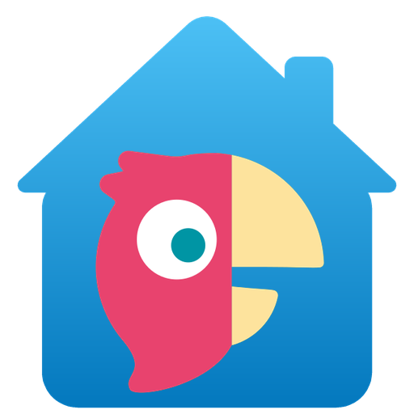

<!-- ha-marketplace:exclude-start -->
<p align="center">
  
</p>

<h1 align="center">Parro-HA</h1>

<p align="center">
  <strong>Parro for Home Assistant</strong><br>
  Announcements, photos, the school calendar and chats for all your children, in Home Assistant.
</p>

<p align="center">
  <a href="https://github.com/Paulus1337/Parro-HA/releases"></a>
  <a href="https://hacs.xyz"></a>
  
  <a href="https://github.com/Paulus1337/Parro-HA/actions/workflows/validate.yml"></a>
  <a href="LICENSE"></a>
</p>
<!-- ha-marketplace:exclude-end -->

> [!IMPORTANT]
> **Unofficial open-source hobby project.** Parro-HA is made by volunteers in their spare time. It is not made, endorsed or supported by Parro, ParnasSys or Topicus, and it is not an official Parro app. It uses the same private API as the Parro apps, which can change at any time. Please do not contact Parro or your school about it; use the [issue tracker](https://github.com/Paulus1337/Parro-HA/issues) instead.

## Features

- **Easy sign-in**: sign in once with the e-mail address (or username) and password of your Parro account. The password goes only to the official ParnasSys sign-in page and is never stored.
- **Stays signed in**: the session renews itself, like in the Parro app.
- **All your children**: each child gets a photo, a class sensor and a personal calendar.
- **School calendar** with all activities, ready for calendar cards and automations.
- **Announcements**: the latest announcement plus a list of recent ones, with title, group, author and text, and an event for every new announcement.
- **Recent photos** from announcements as image entities (opt-in).
- **Chats**: unread counters, conversation details (opt-in), an event when a conversation gets a new message, and plain-text replies to conversations you allow (off by default).
- **Parro card**: one dashboard card that fills itself with your Parro data.
- **Several parents, one dashboard**: each parent signs in with their own Parro account, and the Parro card shows everyone their own account.
- **Privacy first**: nothing is marked as read, and passwords, tokens, names and message texts never appear in logs or diagnostics. See [Privacy and security](#privacy-and-security).
- **English and Dutch**.

## Requirements

- Home Assistant 2025.8 or newer.
- A Parro parent (guardian) account that signs in with an e-mail address (or username) and password. Accounts that sign in with Microsoft or Google, and accounts with two-step verification, are not supported.

## Quick start

1. Add this repository (`https://github.com/Paulus1337/Parro-HA`) to the Marketplace or HACS and install **Parro**. Restart Home Assistant if it asks you to.
2. Go to **Settings > Devices & services > Add integration > Parro** and [sign in](#setup).
3. Add the Parro card to a dashboard: in the dashboard editor, select **Add card** and pick **Parro** (see [Parro card](#parro-card)).
4. Optional: get a notification for every new announcement, as described under [Notifications](#notifications).

<!-- ha-marketplace:exclude-start -->
## Installation

### Marketplace or HACS (recommended)

[](https://my.home-assistant.io/redirect/hacs_repository/?owner=Paulus1337&repository=Parro-HA&category=integration)

1. Click the button above. It opens the Marketplace (Home Assistant 2026.11 and newer) or HACS (older versions). You can also add `https://github.com/Paulus1337/Parro-HA` as a custom repository of type **Integration**.
2. Install **Parro**. Restart Home Assistant if it asks you to.

### Manual

1. Copy `custom_components/parro_ha` into the `custom_components` folder of your Home Assistant configuration.
2. Restart Home Assistant.
<!-- ha-marketplace:exclude-end -->

## Setup

[](https://my.home-assistant.io/redirect/config_flow_start/?domain=parro_ha)

> [!WARNING]
> ParnasSys locks an account after a few wrong passwords, and Home Assistant never retries a password on its own. Make sure the password works in the Parro app or on talk.parro.com before you type it into Home Assistant.

1. Go to **Settings > Devices & services > Add integration > Parro**.
2. Enter the e-mail address (or username) and password of your Parro account.
3. In the same form, under **Home Assistant user**, choose the Home Assistant user the Parro account belongs to (you, by default). The [Parro card](#parro-card) shows the account to that user, and replies by that user go out from it.
4. Select **Submit**. If one sign-in covers several Parro accounts, Home Assistant asks which one to use.

If the session ever ends, Home Assistant asks you to sign in again. Signing in again keeps the chosen Home Assistant user. To link the account to another Home Assistant user later, delete the Parro entry and add it again.

### More than one Parro account

Every Parro entry and its account device are named Parro. If you add more than one account, rename each additional Parro entry and its Parro device right after setup, for example to *Parro 2*, and let Home Assistant rename the entity IDs too. Otherwise the accounts look the same, and the entity IDs of the second one only differ by `_2` at the end. Do not use a person's name: it would become part of the entity ID and the name of every entity of that account, which the history and the entity registry keep.

### Options

| Option | Default | What it does |
| --- | --- | --- |
| Update interval | 10 min | How often Parro is checked (5 to 120 minutes). |
| Announcements to keep | 10 | Recent announcements in the attributes of *Latest announcement* (up to 20). |
| Recent photos | 0 (off) | Number of *Recent photo* image entities (up to 12). Off by default, because class photos usually show other people's children. |
| Show conversation details | Off | Adds the names and last message of each conversation to *Unread conversations*, and the sender and message to chat events. |
| Conversations Home Assistant may reply to | None | One-to-one and family conversations that the *Send chat reply* action may reply to. None means replies are off. |

Changing an option reloads the integration.

## Parro card

The integration makes the **Parro card** available on every dashboard. It fills itself with the Parro account of the user who looks at it: the unread counters, the recent announcements and conversations, the next calendar item and the school calendar, each child's photo and class, and the recent photos. It finds the entities itself, in every language and after renames, and leaves out what is turned off. It adapts to phones, tablets and desktops.

- In the dashboard editor, select **Add card** and pick **Parro**. In YAML it is `type: custom:parro-card`, without options.
- Or use [`examples/dashboard.yaml`](examples/dashboard.yaml), a dashboard with one view that shows the card at full width. Go to **Settings > Dashboards > Add dashboard > New dashboard from scratch** and open the dashboard. Select **Edit dashboard** (the pencil at the top, or in the three-dot menu on a narrow screen), then open the three-dot menu and select **Raw configuration editor**. Paste the file and save.

If the card is missing right after installing or updating Parro-HA, reload the page or restart the Home Assistant app. The list of conversations and the reply form need **Show conversation details**. The list shows the 10 most recent conversations, and the form only offers those of them that Home Assistant may reply to; reply to the others with the [Send chat reply](#sending-chat-replies) action. Recent photos only show when **Recent photos** is set in the Parro options.

> [!NOTE]
> Parro texts are written by other people, so never put them into a Markdown card unescaped: an image link or HTML in an announcement would make every browser that opens the dashboard load an image from someone else's server. The Parro card escapes every Parro text with `replace('<', '&lt;') | replace('[', '&#91;') | replace('_', '&#95;') | replace('*', '&#42;')`, so it shows exactly as written and can hold no links in disguise. Do the same in your own Markdown cards.

## Notifications

A phone notification for every new announcement. Go to **Settings > Automations & scenes > Create automation > Create new automation**, open the three-dot menu, select **Edit in YAML**, replace the text with this and save:

```yaml
alias: "Parro: new announcement"
mode: queued
triggers:
  - trigger: state
    entity_id: event.parro_announcement
conditions:
  - "{{ trigger.from_state and trigger.to_state and 'unavailable' not in (trigger.from_state.state, trigger.to_state.state) }}"
actions:
  - action: notify.mobile_app_your_phone
    data:
      title: "{{ trigger.to_state.attributes.group }}"
      message: "{{ trigger.to_state.attributes.title }}"
```

- Replace `notify.mobile_app_your_phone` with the notify action of your own phone. Do not use `notify.notify`: it sends to every phone with the Home Assistant app.
- With Home Assistant in Dutch, the entity is `event.parro_bericht`.
- Keep the condition and `mode: queued`. [Events](#events) explains why.

## Several parents

Each parent signs in with their own Parro account. One shared dashboard then shows every parent their own announcements, conversations and calendars, and replies go out under their own name.

The stored Home Assistant user ID decides whose Parro account is used, not who can see the data: Home Assistant still lets every user read every entity (see [Privacy and security](#privacy-and-security)).

1. An administrator opens **Settings > Devices & services > Add integration > Parro**, because only administrators can add integrations. There the parent enters the e-mail address (or username) and password of their own Parro account, picks their own Home Assistant user under **Home Assistant user** in the same form, and then selects **Submit**. Repeat this for the other parent, and rename the second Parro entry and its device as described in [More than one Parro account](#more-than-one-parro-account).
2. Add the [Parro card](#parro-card) to a dashboard that both parents use. It shows everyone the Parro account of their own Home Assistant user.
3. An administrator makes a notification automation for each parent, as described under [Notifications](#notifications), with the event entities of that parent's Parro entry and the notify action of that parent's phone. For example, for the second parent, with the entry renamed to *Parro 2*:

```yaml
alias: "Parro 2: new announcement"
mode: queued
triggers:
  - trigger: state
    entity_id: event.parro_2_announcement
conditions:
  - "{{ trigger.from_state and trigger.to_state and 'unavailable' not in (trigger.from_state.state, trigger.to_state.state) }}"
actions:
  - action: notify.mobile_app_phone_2
    data:
      title: "{{ trigger.to_state.attributes.group }}"
      message: "{{ trigger.to_state.attributes.title }}"
```

Replies from the card, and calls of `parro_ha.send_message` without `config_entry_id`, always go out from the account of the user who sends them. An account that belongs to a Home Assistant user only accepts that user, also when someone else is an administrator, so a parent cannot send as the other parent from the card or with the action. Automations run without a user and can send from every account: every administrator can create one, and every user can run one with `automation.trigger` (see [Sending chat replies](#sending-chat-replies)).

## Entities

The integration creates a **Parro** device for your account and a device for each child, named after the child's first name.

| Entity ID | Dutch entity ID | Device | Description |
| --- | --- | --- | --- |
| `sensor.parro_unread_announcements` | `sensor.parro_ongelezen_berichten` | Parro | Unread announcements. |
| `sensor.parro_unread_conversations` | `sensor.parro_ongelezen_gesprekken` | Parro | Conversations with unread messages. With conversation details on, the 10 most recent conversations are listed in the `conversations` attribute, each with `id`, `type`, `name`, `members`, `unread`, `last_message_at`, `last_sender`, `preview` and `can_reply`. |
| `sensor.parro_unread_calendar_items` | `sensor.parro_ongelezen_agenda_items` | Parro | Unread calendar items (disabled by default). |
| `sensor.parro_latest_announcement` | `sensor.parro_laatste_bericht` | Parro | Time of the newest announcement. Attributes: `title`, `group`, `author`, `published`, `text`, `photos`, `attachments`, `read`, `pinned` and `announcements` (recent announcements with the same fields). |
| `sensor.parro_next_event` | `sensor.parro_volgende_activiteit` | Parro | Start of the current or next calendar item. Attributes: `title`, `start`, `end`, `all_day`, `groups` and `upcoming` (the next 10 items). |
| `calendar.parro_school_calendar` | `calendar.parro_schoolagenda` | Parro | All calendar items. |
| `event.parro_announcement` | `event.parro_bericht` | Parro | Fires `new_announcement` with `title`, `group`, `author`, `published` and `photos`. |
| `event.parro_chat_message` | `event.parro_chatbericht` | Parro | Fires `new_chat_message` with `conversation_id`, `conversation_type` and `received`, plus `sender` and `preview` with conversation details on. Only when conversation details or replies are on; it is removed when both are off. |
| `image.parro_recent_photo_1` and up | `image.parro_recente_foto_1` and up | Parro | The most recent photos from announcements, newest first. Only when *Recent photos* is set in the options. |
| `image.<child>_photo` | `image.<child>_foto` | Child | Profile photo of the child. |
| `sensor.<child>_class` | `sensor.<child>_groep` | Child | The child's class, with the school year and unread announcements. |
| `calendar.<child>_calendar` | `calendar.<child>_agenda` | Child | Calendar items for this child. |

Home Assistant creates the entity IDs once, in its own language (**Settings > System > General**): Dutch IDs when Home Assistant is set to Dutch, English IDs in every other language. Changing the language later does not change them. The IDs of child entities start with the child's first name, and an ID that is already taken gets `_2` at the end. Use your own entity IDs wherever this README shows one.

## Sending chat replies

The **Send chat reply** action (`parro_ha.send_message`) sends a plain-text reply to a one-to-one or family conversation that you allowed in the options. The message must be plain text of up to 1000 characters and 20 lines. Links, e-mail addresses, HTML tags and HTML entities such as `&amp;`, backticks, backslashes, square and curly brackets (so also markdown links and template code), values such as `unavailable` and empty messages are refused, and a refused message is never shortened or sent in part. The same message is not sent twice to a conversation within 6 hours.

```yaml
action: parro_ha.send_message
data:
  config_entry_id: YOUR_PARRO_ENTRY_ID
  conversation_id: "123456"
  message: "Thank you, we will bring it tomorrow."
```

The `conversation_id` is the `id` of an item in the `conversations` attribute of *Unread conversations* (with conversation details on), and the `conversation_id` of every chat message event. In the action editor, pick the account under *Parro account*; in YAML, `"{{ config_entry_id('event.parro_chat_message') }}"` gives its entry ID.

Who can send from which account:

- Without `config_entry_id`, the reply goes out from your own account: the Parro entry of the Home Assistant user who runs the action, as in the [Parro card](#parro-card). If there is none, or it is not loaded, the action fails with "Could not find which Parro account should send the reply".
- A user can only send from the Parro account that belongs to them, also when they are an administrator.
- Automations, and scripts that they start, run without a user. They can send from any account, but must give `config_entry_id`.
- Every Home Assistant user can run any automation with `automation.trigger`, which skips its conditions and can replace its variables. Voice assistants also run actions without a user. So in an automation that replies, take the conversation only from a state trigger on your own chat message entity, and write the text in the action itself. Never take either from event, webhook, sentence or MQTT triggers, variables, helpers or scripts that others can reach.

## Privacy and security

This integration handles data about children, so it is built to expose as little as possible.

- **Your password is never stored.** Your sign-in name and password are sent once, only to the official ParnasSys sign-in page. Home Assistant only keeps the session tokens, like every other cloud integration, together with the ID of the Home Assistant user they belong to. It never retries a password on its own.
- **Nothing is marked as read.** Only lists are read, the same ones the Parro app shows on its home screen. Messages are never opened, so teachers do not see them as read.
- **Replies only where you allow them.** The only thing the integration ever sends is a chat reply in plain text, without links, e-mail addresses, HTML or code. It only goes to one-to-one and family conversations that you chose in the options. Only the Home Assistant user the account belongs to, or something that runs without a user such as an automation, can send it. Each account sends at most 5 replies per hour and 20 per day, and at most one per minute to the same conversation.
- **No media links.** Photos are downloaded over a verified (TLS) connection, only from Parro's own media hosts, and only shown through Home Assistant's image proxy. Parro media links never appear in entity attributes or logs.
- **Recent photos are opt-in.** Class photos usually show other people's children, so recent photos are off until you turn them on. Only your own children's profile photos are on by default.
- **Less in your history.** Announcement titles and texts, author and sender names, conversation names, the chat texts shown in Parro entities and calendar item titles are excluded from the recorder database. The history does keep some details, and Home Assistant itself records the text of every reply you send. [What Home Assistant stores](#what-home-assistant-stores) lists both, and [Keep Parro data out of the history](#keep-parro-data-out-of-the-history) shows how to leave them out.
- **Other parents stay anonymous.** Conversation details are off by default. When they are on, group conversations show their title and a member count, never the names of other parents.
- **Safe diagnostics and logs.** Diagnostics only contain counts and settings, so they can be shared in bug reports. Logs and error messages never contain passwords, tokens, sign-in codes or links, media links, names or message texts.
- **No extra packages.** The integration only uses libraries that come with Home Assistant, and only talks to Parro.

Anyone who can open your Home Assistant can see this information: every [Home Assistant user](https://www.home-assistant.io/docs/authentication/) can read all Parro entities and their history, also when a dashboard is hidden from them. Keep Parro entities away from voice assistants, AI conversation agents and cloud services, so that school data stays in your home. Mobile notifications with message texts pass through the push services of Apple or Google. To report a security problem, see the [security policy](SECURITY.md).

### What Home Assistant stores

All of these files are part of your backups, so use encrypted backups.

- **Parro entry** (`.storage/core.config_entries`): only the session tokens, the ID of the Home Assistant user they belong to and the number of your Parro account, besides your options.
- **History** (the recorder database, 10 days by default, see `purge_keep_days`): the entity names, which contain your children's first names; each child's class and school year; the counters; the time of the newest announcement and whether it is read or pinned; the time and photo count of every announcement event; the start time of the next calendar item; when calendar items start and end (the on and off times of the calendars); and the time, conversation number and type of every chat message event.
- **Replies**: Home Assistant itself stores every call of `parro_ha.send_message` in the history as a `call_service` event, with the message text, the conversation number and the entry ID. Refused replies are stored too, because Home Assistant records the call before the integration checks it.
- **Traces** (`.storage/trace.saved_traces`): the traces of automations and scripts keep the call as well, and the Parro state that started them with all its attributes, such as the title and author of an announcement or the sender and preview of a chat message.
- **Last event** (`.storage/core.restore_state`): the last announcement and chat message event, with its attributes, so it survives a restart, until the next event replaces it. When the Parro entry is deleted, or the chat message event is removed because conversation details and replies are both off, Home Assistant still keeps that last event there for up to 7 days.
- **Reply limits** (`.storage/parro_ha.<entry_id>.replies`): the times and conversation numbers of reply attempts for 24 hours, a fingerprint of the text only for the 6 hours in which the same message counts as a duplicate, and, after Parro refused a reply, when the one-hour pause ends. The text itself is never stored. Home Assistant removes outdated attempts and fingerprints as soon as it starts setting up the Parro entry, even if that setup fails, and from then on removes each one as soon as it expires, until Home Assistant stops. While Home Assistant is stopped, or after it started with the Parro entry disabled, they stay in the file until the entry is set up again or deleted.
- **Registries** (`.storage/core.entity_registry` and `.storage/core.device_registry`): the entity IDs and device names, which contain your children's first names, and the Parro numbers of your account and each child, which identify the entities and devices. The entity registry also remembers removed entities, with any names you gave them: while the Parro entry exists, those of a child that is no longer linked; after the entry is deleted, all Parro entities for at least 30 days. The device registry does the same with names you gave devices.

Deleting the Parro entry removes the tokens, the user ID and the reply limits, and asks ParnasSys to end the session.

### Keep Parro data out of the history

To keep replies and Parro entities out of the history, add this to `configuration.yaml`, with the entity IDs of each of your children (in Dutch they end in `_groep`, `_foto` and `_agenda`):

```yaml
recorder:
  exclude:
    event_types:
      - call_service
    entity_globs:
      - "*.parro_*"
    entities:
      - sensor.alex_class
      - image.alex_photo
      - calendar.alex_calendar
```

If `configuration.yaml` already has a `recorder:` section, add these lines to it, because a second `recorder:` replaces the first. Excluding `call_service` leaves the calls of every action out of the history, not only Parro's. Excluded entities have no history graphs or logbook entries.

## Known limitations

- Parro has no public API. The integration uses the same private API as the Parro apps, so it can stop working when Parro changes it.
- One Parro entry is one account at one school. If your sign-in covers several accounts, add the integration once for each.
- The Parro card shows one Parro account per Home Assistant user. If several Parro entries belong to the same user, the card, and replies without `config_entry_id`, use the loaded one that was added first. Put the entities of the others in your own cards, and reply from them with their `config_entry_id`.
- If one Parro account has parent roles at two schools, only one of the schools is shown.
- Messages in a conversation are not read one by one, so that nothing is marked as read. The integration sees the latest message of each conversation.
- Replies are only possible in one-to-one and family conversations.
- Some Parro data is deliberately left out: medical and contact details, photo consent, birthdays of classmates, absence reports and special-needs documents. They are sensitive data about children and not needed for a dashboard.
- Repositories added from a link are checked for updates by the Marketplace every 48 hours, and only when Home Assistant is connected to GitHub.

## Troubleshooting

- **The password is refused**: check it in the Parro app or on talk.parro.com first. Use the password reset there, or ask your school if the Parro app does not work either.
- **Account locked**: ParnasSys locks an account after a few wrong passwords. Reset your password or ask your school.
- **"The Parro sign-in page did not respond as expected"**: Parro may have changed its sign-in page. Nothing was retried. Check for an update of Parro-HA.
- **"Parro did not confirm whether your password was accepted"**: Parro gave no clear answer after the password was sent, for example because the connection dropped. Check that you can still sign in to Parro itself, then try again.
- **Asked to sign in again after restoring a backup**: the session can only live in one place. See [Sign-in and session](#sign-in-and-session).
- **The Parro card says "Ask an administrator to add Parro and sign in with your own Parro account"**: no loaded Parro entry belongs to your Home Assistant user. See [Several parents](#several-parents).
- **Debug logging**: add the following to `configuration.yaml`, or to its `logger:` section if it already has one. Logs never contain passwords, tokens, sign-in codes or links, media links, names or message texts.

  ```yaml
  logger:
    logs:
      custom_components.parro_ha: debug
  ```

## Removal

1. Remove the Parro card from your dashboards; without the integration it shows an error.
2. Delete the Parro entry in **Settings > Devices & services**. This removes the stored session, its Home Assistant user ID and the reply limits, and asks ParnasSys to end the session.
3. Remove the integration in the Marketplace or HACS, or delete `custom_components/parro_ha`.

To remove one parent, delete only their Parro entry. Deleting just their Home Assistant user keeps their Parro session.

Home Assistant itself still keeps the last announcement and chat message event in `.storage/core.restore_state` for up to 7 days, and the history until the recorder purges it (10 days by default). The entity and device registries remember the deleted entity IDs, which contain your children's first names, the Parro numbers of your account and children, and any names you gave the entities or devices, for at least 30 days. Backups made in that time contain them too.

## How it works

This section documents the design, so the code itself can stay small.

### Sign-in and session

- Home Assistant signs in the way the Parro app does: an OAuth 2.0 authorization code flow with PKCE against the ParnasSys sign-in service, as the app's own client. Sessions of the Parro web client end after a few hours; sessions of the app keep renewing, which is what a home server needs.
- Your sign-in name and password are typed into Home Assistant and posted once to the sign-in form on `inloggen.parnassys.net`. Every request of the sign-in stays on that host, over TLS, with its own cookies that are thrown away afterwards. Redirects are followed by hand, and a sign-in loads at most 40 pages before it exchanges the code for the tokens.
- The password is only sent when the page is the sign-in form that is expected. If the page looks different, nothing is sent and you see "The Parro sign-in page did not respond as expected".
- Every submit is exactly one attempt. A rejected, unclear or interrupted sign-in is never repeated automatically, because ParnasSys locks an account after a few wrong passwords. If Parro gives no clear answer after the password was sent, Home Assistant tells you so and asks you to check your password in the Parro app first.
- If one sign-in covers several accounts, Home Assistant shows the list from the sign-in page and never picks one for you.
- The answer of the sign-in service is only accepted when it comes back to the app's own address with the one-time state value that Home Assistant made up for this sign-in.
- Home Assistant stores the access token and the refresh token in the config entry. The access token is renewed two minutes before it ends. Parro replaces the refresh token every time it is used, and the new one is saved at once.
- Because refresh tokens are single-use, one session can only live in one place. A backup restored on a second Home Assistant, or a copy of the configuration on a test system, signs the other one out. Sign in again on the system you want to keep.
- When Parro refuses the session, Home Assistant asks you to sign in again. When Parro is unreachable or has an outage, the session is kept and tried again later.
- The account that signs in again must be the account that was set up. Data of another account is never shown under the same entities.

### What is read from Parro

Parro is checked every 10 minutes by default (5 to 120 minutes in the options). Each update reads: the account (every 12 hours), the children, the groups, the unread counters, the newest announcements of each group, the calendar from yesterday onwards, and, only when conversation details or replies are on, the list of conversations. After a chat reply, the conversations are read again right away. Calendar cards ask for their own period; the answer is shared by all calendars for two minutes. Each update runs at most three requests at the same time, and lists are read in pages of 50.

Only these lists are read. Home Assistant never opens an announcement or a conversation and never calls anything that marks items as read. Of every conversation only the latest message is known, because that is part of the list.

Parts that Parro refuses for your account, such as the calendar at some schools, are left empty, also in calendar views, and do not stop the rest.

Parro stores multi-day calendar items as one row per day; Home Assistant merges them into one event. All-day items end on the day after their last day, as calendars expect.

### How replies are checked

Replies are off until you choose conversations in the options. Only one-to-one and family conversations in which replies are allowed can be chosen. Group conversations cannot. The list shows while the Parro entry is loaded and Parro can be reached, when there is a conversation to choose or a choice to clear; otherwise the earlier choice is kept. Saving the options keeps only the conversations listed at that moment, so when none of them can get a reply any more, saving turns replies off.

Before a reply is sent, Home Assistant checks, in this order: the conversation is allowed in the options; the text is plain text; the limits are not exceeded; the conversation still exists and still accepts replies. Then the reply is sent once.

- The text is cleaned (invisible and control characters are removed, line endings are made the same) but never shortened. Text with a link or an e-mail address, with HTML or code (HTML tags and HTML entities, backticks, backslashes, square and curly brackets, so also markdown links and template code such as `{{ }}`), or that is only `unknown`, `unavailable`, `none` or `null` is refused, so a broken automation cannot send nonsense to a teacher and no reply can carry code into Parro.
- The limits count attempts, not only successful replies: one per conversation per minute, 5 per hour and 20 per day, and no identical message to the same conversation within 6 hours. They survive restarts and reloads. A reply that certainly did not reach Parro does not count as a duplicate, so you can send it again.
- A reply is never repeated automatically. If Parro does not confirm it, you are told to check the conversation in Parro first. If Parro refuses a reply, sending pauses for an hour.
- Who can send, and how to keep reply automations safe, is described under [Sending chat replies](#sending-chat-replies).

### Events

`event.parro_announcement` (`event.parro_bericht` in Dutch) fires once for every announcement that appears after Home Assistant started. Announcements that already existed, and older ones that move into view when a newer one is deleted, do not fire. `event.parro_chat_message` (`event.parro_chatbericht`) fires when someone else writes in a conversation; your own messages and messages from before Home Assistant started do not fire.

Both event entities stay available when Parro cannot be reached, so an outage never looks like a new event. A restart or reload does briefly make them unavailable, so skip changes from or to `unavailable` as the condition in the [notification example](#notifications) does; otherwise the automation runs again for the last event. One update can bring several events, so keep `mode: queued` and give the trigger no `from`, `to`, `not_from` or `not_to`: older Home Assistant versions give events of the same millisecond the same state.

### Photos

Parro media links work without signing in, so they are treated as secrets. Home Assistant downloads the images itself, only over HTTPS from Parro's own media hosts, without following redirects, up to 15 MB per image, and serves them through its image proxy. After a failed download the same image is tried again after five minutes.

### Devices

When a child is no longer linked to your account, its device and entities are removed at the first update that still lists at least one child. If the child is linked again, its entities come back.

## Contributing

Contributions are welcome. Please open an issue first to discuss the change. Never add real Parro data, such as names, messages or photos, to issues or pull requests.

The code has no comments on purpose: this README is the documentation. Every push is checked by hassfest and the HACS action, in a workflow that can only read this repository and has no secrets.

## License and trademarks

Parro-HA is released under the [MIT license](LICENSE). Parro, ParnasSys and the Parro parrot are trademarks of their respective owners. The icon places the Parro parrot in a house only to show which service the integration works with. Parro-HA is not affiliated with, endorsed by or sponsored by Parro, ParnasSys or Topicus.
