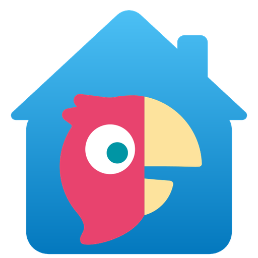
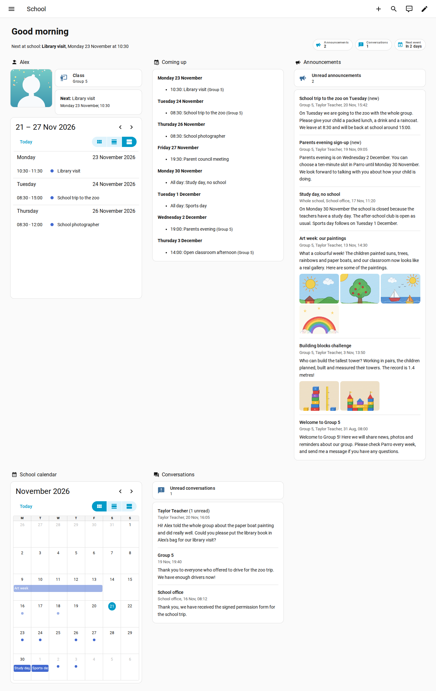
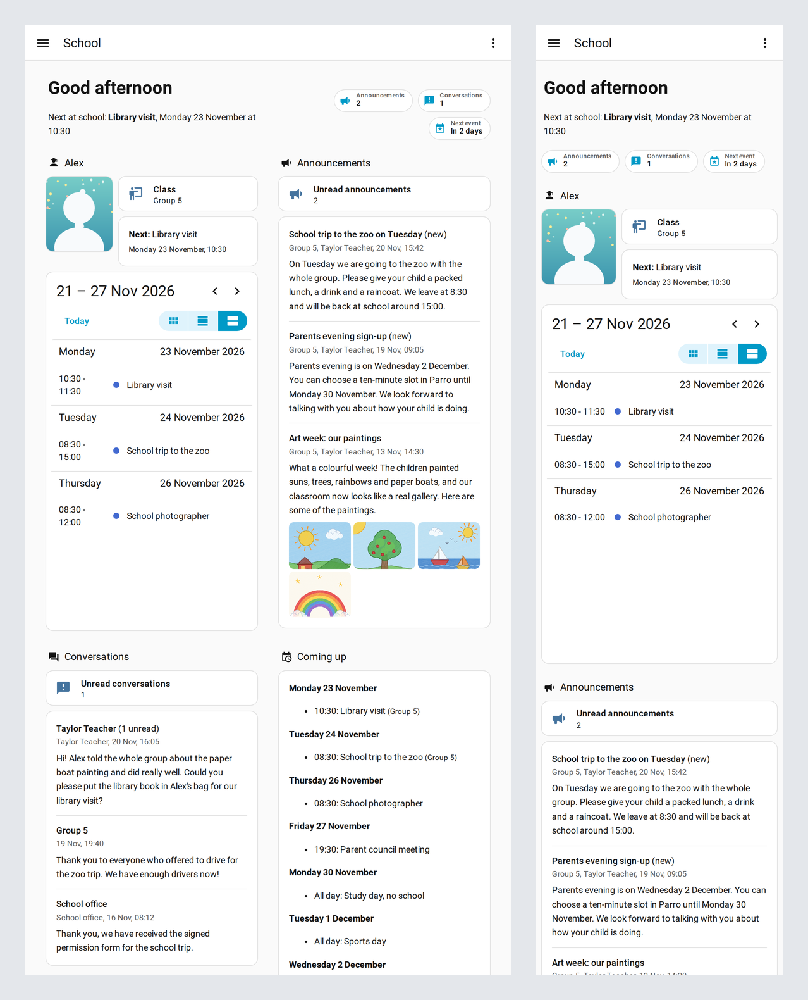

<p align="center">
  
</p>

<h1 align="center">Parro-HA</h1>

<p align="center">
  <strong>Parro for Home Assistant</strong><br>
  Announcements, photos, the school calendar and chats for all your children, in Home Assistant.
</p>

<p align="center">
  <a href="https://github.com/Paulus1337/Parro-HA/releases"></a>
  
  <a href="https://github.com/Paulus1337/Parro-HA/actions/workflows/validate.yml"></a>
  <a href="LICENSE"></a>
</p>

> [!IMPORTANT]
> **Unofficial open-source hobby project.** Parro-HA is made by volunteers in their spare time. It is not made, endorsed or supported by Parro, ParnasSys or Topicus, and it is not an official Parro app. It uses the same private API as the Parro apps, which can change at any time. Please do not contact Parro or your school about it; use the [issue tracker](https://github.com/Paulus1337/Parro-HA/issues) instead.

## What you get

- **All school news on one card.** The [Parro card](#parro-card) shows the announcements with their photos, the conversations with a reply form, your children and the school calendar. Tap a photo to see it larger.
- **A phone notification for every new announcement**, with its title, from a [ready-made automation](#notifications).
- **Quick pop-ups.** Tap the unread counters, the latest announcement or the next event anywhere in Home Assistant to read what is new or what is coming up.
- **The school calendar** in Home Assistant, for calendar cards and automations.
- **Your children, if you want them** (off by default): each child gets a class sensor, their own calendar and, if you like, their profile photo.
- **Replies to teachers** in plain text, from the card or an automation, only in the conversations you allow (off by default).
- **Automations that know what is new**: an event for every new announcement and chat message, and actions that give automations the texts.
- **One dashboard for the whole family.** Each parent signs in with their own Parro account, and the Parro card shows everyone their own account.
- **Private between users.** Announcement texts, photos and conversations stay out of Home Assistant's entities: only the user an account belongs to, and the users you choose, can read the announcements and photos, and only that user the conversations. Only **Recent photos** and **Profile photos of children** put photos in image entities, which every user can see. Photos are saved again without location or camera data. Accounts added before version 0.4.0 keep their texts in the entities until you turn that off. See [Privacy and security](#privacy-and-security).
- **Nothing is marked as read**, so teachers never see a message as read because of Home Assistant.
- **A safe sign-in that lasts.** Sign in once with the e-mail address (or username) and password of your Parro account. The password only goes to the official ParnasSys sign-in page and is never stored, and the session renews itself, like in the Parro app. Logs and diagnostics never hold passwords, tokens, names or message texts.
- **English and Dutch.**

**Jump to:** [Installation](#installation) | [Setup](#setup) | [Parro card](#parro-card) | [Notifications](#notifications) | [Several parents](#several-parents) | [Automations](#reading-parro-texts-in-automations) | [Privacy](#privacy-and-security) | [Troubleshooting](#troubleshooting)

## Requirements

- Home Assistant 2025.8 or newer. The Marketplace is built into Home Assistant 2026.11 and newer; on older versions, install Parro-HA with HACS or by hand.
- A Parro parent (guardian) account that signs in with an e-mail address (or username) and password. Accounts that sign in with Microsoft or Google, and accounts with two-step verification, are not supported.

## Quick start

1. Search for **Parro** in the Marketplace or HACS and install the one by **Paulus1337**; another integration is also called Parro. Restart Home Assistant if it asks you to.
2. Go to **Settings > Devices & services > Add integration > Parro** and [sign in](#setup).
3. Add the Parro card to a dashboard: in the dashboard editor, select **Add card** and pick **Parro** (see [Parro card](#parro-card)). If it is not in the list, reload the page or restart the Home Assistant app.
4. Optional: get a phone notification for every new announcement, as described under [Notifications](#notifications).

## Installation

### Marketplace or HACS (recommended)

Parro-HA is in the default catalog of the Marketplace and HACS.

1. Open the Marketplace (Home Assistant 2026.11 and newer) or HACS (older versions) and search for **Parro**. Pick the one by **Paulus1337** (repository `Paulus1337/Parro-HA`): another integration in the catalog is also called Parro. The button below opens Parro-HA there directly.
2. Install it. Restart Home Assistant if it asks you to.

[](https://my.home-assistant.io/redirect/hacs_repository/?owner=Paulus1337&repository=Parro-HA&category=integration)

Did you add Parro-HA from its repository link before it was in the catalog? Then there is nothing to do: it keeps getting updates.

### Manual

1. Download **Source code (zip)** of the [latest release](https://github.com/Paulus1337/Parro-HA/releases/latest), unpack it and copy `custom_components/parro_ha` into the `custom_components` folder of your Home Assistant configuration. To update, replace the whole folder with the one of the new release.
2. Restart Home Assistant.

## Setup

[](https://my.home-assistant.io/redirect/config_flow_start/?domain=parro_ha)

> [!WARNING]
> ParnasSys locks an account after a few wrong passwords, and Home Assistant never retries a password on its own. Make sure the password works in the Parro app or on talk.parro.com before you type it into Home Assistant.

1. Go to **Settings > Devices & services > Add integration > Parro**.
2. Enter the e-mail address (or username) and password of your Parro account.
3. In the same form, under **Home Assistant user**, choose who the Parro account belongs to (you, by default). The [Parro card](#parro-card) shows the account to that user, only that user sees its conversations, and only that user and automations can reply from it.
4. Select **Submit**. If one sign-in covers several Parro accounts, Home Assistant asks which one to use.
5. Optional: turn on **Children** in the [options](#options) for a device, class and calendar for each child.

If the session ever ends, Home Assistant asks you to sign in again, and the account stays with the same Home Assistant user. To give the account to another Home Assistant user, open the three-dot menu of the Parro entry in **Settings > Devices & services > Parro** and select **Reconfigure**. You do not sign in again: the integration reloads, as after changing an option, and the new user is taken off **Other users who can read this account**.

### More than one Parro account

Every Parro entry and its account device are named Parro. If you add more than one account, rename each additional Parro entry and its Parro device right after setup, for example to *Parro 2*, and let Home Assistant rename the entity IDs too. Otherwise the accounts look the same, and the entity IDs of the second one only differ by `_2` at the end. Do not use a person's name: it would become part of the entity ID and the name of every entity of that account, which the history and the entity registry keep.

Another Parro integration, [ha-parro](https://github.com/carlmegens/ha-parro), also names its device Parro and uses some of the same entity names. If you run both, the one that is set up second gets entity IDs ending in `_2`, so check the entity IDs in your own cards and automations. The Parro card finds its own entities and is not affected.

### Options

To change the options, go to **Settings > Devices & services > Parro** and select **Configure** (the cogwheel) next to the Parro entry.

| Option | Default | What it does |
| --- | --- | --- |
| Update interval | 10 min | How often Parro is checked (5 to 120 minutes). |
| Announcements to keep | 10 | Recent announcements in the Parro card, the pop-ups, the *Get announcements* action and, with **Show announcement details**, *Latest announcement* (up to 20). |
| Recent photos | 0 (off) | Number of *Recent photo* image entities (up to 12). The Parro card and the announcement pop-ups show them in a **Recent photos** block. Off by default, because class photos usually show other people's children and every Home Assistant user can see image entities. |
| Children | Off | A device for each child with a class sensor and a personal calendar. Off by default, because device and entity names contain your children's first names, which every Home Assistant user can see. |
| Profile photos of children | Off | An image entity with each child's profile photo. Needs **Children**. |
| Photos with announcements | On (off for accounts added before 0.4.0) | The Parro card and the pop-ups show up to 4 photos under each announcement, only to the account's own user and the users chosen below. |
| Conversations in the Parro card | On (for accounts added before 0.4.0, the setting of *Show conversation details*) | The Parro card and the pop-ups show the conversations and the reply form to the account's own user. Parro-HA only reads the list of conversations when this, *Show conversation details* or a reply conversation needs it, and when you open the options, to fill *Conversations Home Assistant may reply to*. |
| Show announcement details | Off (on for accounts added before 0.4.0) | Puts the title, text and author of the recent announcements in the attributes of *Latest announcement*, the title of the newest announcement in each class sensor, the title and group in the recent photos, and the title, group and author in announcement events, as before version 0.4.0. Every Home Assistant user can read these, so the announcement pop-ups show them to everyone who opens them. The account's own user and the users chosen below read the announcements in the Parro card without it. |
| Show conversation details | Off | Puts the names and last message of the 10 most recent conversations in the attributes of *Unread conversations*, and the sender and message in chat message events. Every Home Assistant user can read these, so the *Unread conversations* pop-up shows them to everyone who opens it. |
| Other users who can read this account | None | Home Assistant users who, besides the user of the account, can read its announcements and photos in the Parro card and the pop-ups. Conversations and replies stay with the account's own user. |
| Conversations Home Assistant may reply to | None | One-to-one and family conversations that the reply form of the Parro card and the *Send chat reply* action may reply to. None means replies are off. |

Changing an option reloads the integration. Entries made before version 0.4.0 keep working as before: **Children**, **Profile photos of children** and **Show announcement details** stay on, **Show conversation details** keeps its setting, **Photos with announcements** starts off and **Conversations in the Parro card** starts with the setting of **Show conversation details**, so their cards, pop-ups and automations look and work as they did. While a details option is on, **Settings > Repairs** reminds you that every Home Assistant user can read those texts. Once your cards and automations use the [Parro card](#parro-card) and the [actions](#reading-parro-texts-in-automations), turn both details options off to keep the texts between the users who may read them.

## Parro card

The **Parro card** brings everything from Parro together on one dashboard card: the unread counters, the recent announcements with their photos, the recent photos, the conversations with a reply form, each child's photo and class, the next calendar item and the school calendar. It shows the Parro account of the user who looks at it, so one dashboard works for the whole family. Users without a Parro account of their own see an account they may read (see [Several parents](#several-parents)), or a short note. The card follows changes without a page reload and adapts to phones, tablets and desktops.

### Add the card

In the dashboard editor, select **Add card** and pick **Parro**. The card editor has:

- **Title**: a title above the card.
- **Parro account**: leave it empty to show the account of whoever looks at the card, or pick one account, for example for a wall tablet. The field only lists the accounts you may read, and is hidden when there are none. For an account that is not listed, set `account` in YAML to its entry ID. To find that entry ID, use the template `{{ config_entry_id('sensor.parro_unread_announcements') }}` with that account's own entity ID. A viewer still only sees an account they may read.
- **Number of announcements**: 1 to 20; empty shows all that Parro-HA keeps (**Announcements to keep** in the options).
- **Group**: only the newest announcements sent to one group, as many as **Announcements to keep**, also when they were sent to more groups. The list offers the groups of the accounts you may read, and you can type another. If nothing was sent to that group, the card says so.
- A switch for every part, all on to start with: **Announcements**, **Children**, **Photos** (the photos under the announcements and the **Recent photos** block), **Conversations**, **Reply form** and **Calendar**. Turn off what a dashboard does not need, such as the conversations and the reply form on a wall tablet; without the reply form the card's **Unread conversations** counter does not open the [pop-up](#pop-ups) either.

In YAML it is `type: custom:parro-ha-card`, with the optional `title`, `account` (the entry ID of a Parro entry), `announcement_count` and `group`, and `show_announcements`, `show_children`, `show_photos`, `show_conversations`, `show_reply` or `show_calendar` set to `false` to leave that part out. Before version 0.2.0 it was `custom:parro-card`, the same name as the card of another Parro integration; a dashboard that still uses that name shows an error until you change it.

### Using the card

- Long announcements show their first 280 characters with **Show more**, which shows the whole text (up to 20000 characters). With **Photos with announcements** on in the options, up to 4 photos show under their announcement, loaded when they scroll into view; tap a photo to see all of it in the full width of the card and in a sharper version, and tap it again to close it. A photo that cannot be shown says so, for example a GIF image: open those in the Parro app. Without that option the announcement says how many photos it has. With **Recent photos** set, a **Recent photos** block shows those image entities, as in version 0.3.
- Conversations and the reply form only show for the account's own user, and only with **Conversations in the Parro card** on. The list shows the 10 most recent conversations with the time of their latest message, its sender in one-to-one and family conversations, and that message (up to 2000 characters) with **Show more** when it is long. The form offers every conversation that Home Assistant may reply to (**Conversations Home Assistant may reply to** in the [options](#options)). If the conversation you picked is no longer offered while you type, the form clears your text, so a reply never goes to another conversation. A half-written reply stays when the card is rebuilt, for example after you save the Parro options. Errors are shown in your language.
- While it loads, and when Parro is not available, the session has ended or you may not read the account, the card says so. When an update fails, it keeps showing the last data with its time.
- Children only show when **Children** is on in the options, and their photo only with **Profile photos of children**.
- If the card is missing right after installing or updating Parro-HA, reload the page or restart the Home Assistant app.

## Pop-ups

Tap **Unread announcements** or **Latest announcement** anywhere in Home Assistant, on a dashboard, a badge or the device page, and Home Assistant's own pop-up shows the recent announcements and photos of that Parro account. Tap **Unread conversations** for the conversations, with the reply form when it is your own account. Tap **Next event** for the next 10 calendar items with their start and end. The pop-up still shows Home Assistant's own history of the sensor.

The pop-up shows what Home Assistant already has: it asks the Parro service nothing extra, never opens a conversation and marks nothing as read. A photo that is not in memory yet is downloaded once from Parro's media host, and once more in its full size when you open it. Announcements and conversations follow the same rules as the [Parro card](#parro-card). Other users only see what their Home Assistant already shows them, as in version 0.3: in the announcement pop-ups the texts that **Show announcement details** puts in the entity attributes, with the **Recent photos**, and in the conversations pop-up the conversations that **Show conversation details** puts there. Without those texts, they see a short note instead.

## Example dashboard

Want a head start? [`examples/dashboard.yaml`](examples/dashboard.yaml) is a complete School dashboard: a greeting with the next school activity, badges for unread announcements, unread conversations and the next activity, the Parro card with the 3 newest announcements and their photos, the child's photo, class and calendar, the Parro card with the conversations, the coming activities and the school calendar. For all recent announcements, tap **Unread announcements** at the top of the card, or change `announcement_count`. The screenshots show made-up data.





1. In the Parro [options](#options), turn on **Children** and **Profile photos of children** for the child section, or leave that section out.
2. Go to **Settings > Dashboards > Add dashboard > New dashboard from scratch** and open the dashboard. Select **Edit dashboard** (the pencil at the top, or in the three-dot menu on a narrow screen), then open the three-dot menu and select **Raw configuration editor**. Replace the text with the content of the file.
3. Replace `alex` in the entity IDs with the start of your child's entity IDs, and `Alex` with your child's name. For more children, copy the child section; with two children, also remove `column_span: 2` from the school calendar, so that it does not move to a row of its own. With Home Assistant in Dutch, use the Dutch entity IDs from [Entities](#entities). Then save.

The Parro cards in the example show every viewer their own account. The other cards name the entities of one account, which every user who opens the dashboard sees; see [Several parents](#several-parents).

> [!NOTE]
> Calendar titles are written by other people, so never put them into a Markdown card unescaped: an image link or HTML in a calendar title would make every browser that opens the dashboard load an image from someone else's server. The example escapes every calendar text with `` replace('&', '&amp;') | replace('<', '&lt;') | replace('>', '&gt;') | replace('[', '&#91;') | replace('_', '&#95;') | replace('*', '&#42;') | replace('`', '&#96;') | replace('~', '&#126;') | replace('\\', '&#92;') | replace(':', '&#58;') | replace('@', '&#64;') | replace('www.', 'www&#46;') | replace('\r\n', '<br>') | replace('\r', '<br>') | replace('\n', '<br>') `` and never starts a line with it. Do the same in your own Markdown cards.

## Notifications

Get a phone notification with the title of every new announcement. Go to **Settings > Automations & scenes > Create automation > Create new automation**, open the three-dot menu, select **Edit in YAML**, replace the text with this, change it as the notes below say and save:

```yaml
alias: "Parro: new announcement"
mode: queued
triggers:
  - trigger: state
    entity_id: event.parro_announcement
conditions:
  - "{{ trigger.from_state and trigger.to_state and 'unavailable' not in (trigger.from_state.state, trigger.to_state.state) }}"
actions:
  - action: parro_ha.get_announcements
    data:
      config_entry_id: "{{ config_entry_id('event.parro_announcement') }}"
    response_variable: parro
  - variables:
      item: "{{ parro.announcements | selectattr('id', 'eq', trigger.to_state.attributes.announcement_id) | first | default({}) }}"
  - action: notify.mobile_app_your_phone
    data:
      title: Parro
      message: "{{ item.title | default('New announcement', true) }}"
```

- Replace `notify.mobile_app_your_phone` with the notify action of your own phone. Do not use `notify.notify`: it sends to every phone with the Home Assistant app.
- With Home Assistant in Dutch, the entity is `event.parro_bericht`.
- Keep the condition and `mode: queued`. [Events](#events) explains why.
- Notifications made before version 0.4.0 read the title from the event itself. They keep working while **Show announcement details** is on; the example above also works with it off.
- Home Assistant keeps the title and message of every notification in the history, and the answer of the action in the automation trace until newer runs replace it. [Keep Parro data out of the history](#keep-parro-data-out-of-the-history) shows how to leave the notifications out of the history.

## Several parents

Each parent signs in with their own Parro account. One shared dashboard then shows every parent their own announcements, conversations and calendars, and replies go out under their own name.

1. An administrator opens **Settings > Devices & services > Add integration > Parro**, because only administrators can add integrations. There the parent enters the e-mail address (or username) and password of their own Parro account, picks their own Home Assistant user under **Home Assistant user** in the same form, and then selects **Submit**. Repeat this for the other parent, and rename the second Parro entry and its device as described in [More than one Parro account](#more-than-one-parro-account).
2. Add the [Parro card](#parro-card) to a dashboard that both parents use. It shows everyone the Parro account of their own Home Assistant user.
3. Optional: for a wall tablet or another user without a Parro account, choose that user under **Other users who can read this account** in the Parro [options](#options), and pick the account in the card editor, or set `account` in YAML if the editor does not list it.
4. An administrator makes a notification automation for each parent, as described under [Notifications](#notifications), with the event entity of that parent's Parro entry and the notify action of that parent's phone. For the second parent, with the entry renamed to *Parro 2*, use `event.parro_2_announcement` in both places.

Good to know:

- Announcement texts, photos and conversations are only given to the Home Assistant user an account belongs to, and to the users chosen under **Other users who can read this account** in its options. That is also true for administrators: an administrator who is not chosen only sees a short note, and can add themselves in the options. Conversations and replies stay with the account's own user.
- With both details options off, the entities hold no texts, only counters, times, numbers, class names, calendar items and the photos of the image entities you turn on, and Home Assistant shows every entity to every user. So any card other than the Parro card that names a Parro entity shows that account's counters and calendar to everyone who opens the dashboard, and with a details option on also those texts; give it a visibility condition for its parent (**Visibility > User** in the card editor) or leave it out.
- Replies from the card, and calls of `parro_ha.send_message` without `config_entry_id`, always go out from the account of the user who sends them. An account that belongs to a Home Assistant user only accepts that user, also when someone else is an administrator, so a parent cannot send as the other parent from the card or with the action. Automations run without a user and can send from every account: every administrator can create one, and every user can run one with `automation.trigger` (see [Sending chat replies](#sending-chat-replies)).

## Entities

The integration creates a **Parro** device for your account and, with **Children** on, a device for each child, named after the child's first name.

| Entity ID | Dutch entity ID | Device | Description |
| --- | --- | --- | --- |
| `sensor.parro_unread_announcements` | `sensor.parro_ongelezen_berichten` | Parro | Unread announcements. Unknown when Parro refuses the counters. |
| `sensor.parro_unread_conversations` | `sensor.parro_ongelezen_gesprekken` | Parro | Conversations with unread messages. Unknown when Parro refuses the counters. With **Show conversation details**, the 10 most recent conversations are listed in the `conversations` attribute, with the fields of *Get conversations*. |
| `sensor.parro_unread_calendar_items` | `sensor.parro_ongelezen_agenda_items` | Parro | Unread calendar items (disabled by default). |
| `sensor.parro_latest_announcement` | `sensor.parro_laatste_bericht` | Parro | Time of the newest announcement. With **Show announcement details**, the attributes `id`, `title`, `group`, `groups` (every group it was sent to), `author`, `published`, `text` (up to 2000 characters), `photos`, `attachments`, `read`, `pinned` and `announcements` (the recent announcements with the same fields, texts up to 500 characters). |
| `sensor.parro_next_event` | `sensor.parro_volgende_activiteit` | Parro | Start of the current or next calendar item; it moves on as soon as that item ends. Attributes: `title`, `start`, `end`, `all_day`, `groups` and `upcoming` (the next 10 items). |
| `calendar.parro_school_calendar` | `calendar.parro_schoolagenda` | Parro | All calendar items. |
| `event.parro_announcement` | `event.parro_bericht` | Parro | Fires `new_announcement` with `announcement_id` and `published`, and with **Show announcement details** also `title`, `group`, `author` and `photos`. |
| `event.parro_chat_message` | `event.parro_chatbericht` | Parro | Fires `new_chat_message` with `conversation_id`, `conversation_type` and `received`, and with **Show conversation details** also `sender` and `preview`. Only while Parro-HA reads the conversations (see **Conversations in the Parro card** in the [options](#options)); otherwise it is removed. |
| `image.parro_recent_photo_1` and up | `image.parro_recente_foto_1` and up | Parro | The most recent photos from announcements, newest first. Only when *Recent photos* is set in the options. With **Show announcement details**, the attributes `title` and `group` of their announcement. |
| `sensor.<child>_class` | `sensor.<child>_groep` | Child | The child's class. Attributes: `school_year`, `unread_announcements` and the time of the class's newest announcement (`last_announcement_at`), with **Show announcement details** also its title (`last_announcement`). Only with **Children** on. |
| `calendar.<child>_calendar` | `calendar.<child>_agenda` | Child | Calendar items for this child. Only with **Children** on. |
| `image.<child>_photo` | `image.<child>_foto` | Child | Profile photo of the child. Only with **Profile photos of children** on. |

Home Assistant creates the entity IDs once, in its own language (**Settings > System > General**, called *Home information* in newer versions): Dutch IDs when Home Assistant is set to Dutch, English IDs in every other language. Changing the language later does not change them. The IDs of child entities start with the child's first name, and an ID that is already taken gets `_2` at the end. Use your own entity IDs wherever this README shows one.

## Reading Parro texts in automations

Two actions give automations the texts that the entities leave out, also with both details options off. They answer from what Home Assistant already has, without asking Parro, and only work as an action with a response (`response_variable`).

- **Get announcements** (`parro_ha.get_announcements`): the newest announcements, each with `id`, `title`, `text` (up to 20000 characters), `author`, `groups`, `published`, `read`, `pinned`, `photos` (a number) and `attachments` (a number). `count` picks how many, at most the number from the options; empty gives that number.
- **Get conversations** (`parro_ha.get_conversations`): the conversations, each with `id`, `type`, `name`, `members` (a number), `unread`, `last_message_at`, `last_sender` (only in one-to-one and family conversations), `preview` (up to 200 characters of the latest message) and `can_reply`. It needs **Conversations in the Parro card**, **Show conversation details** or a reply conversation, because otherwise Parro-HA does not keep the conversations.

```yaml
action: parro_ha.get_conversations
data:
  config_entry_id: "{{ config_entry_id('event.parro_chat_message') }}"
response_variable: parro
```

Without `config_entry_id` they use the Parro entry of the user who runs them; automations must give it. A user can read announcements from their own account and from accounts that list them under **Other users who can read this account**, and conversations only from their own account. Automations run without a user and can read every account. Tools that call actions over Home Assistant's API with an access token, such as Node-RED or AppDaemon, act as the user of that token and get only what that user may read. The answer is kept in the automation trace.

## Sending chat replies

The **Send chat reply** action (`parro_ha.send_message`) sends a plain-text reply to a one-to-one or family conversation that you allowed in the options. The message must be plain text of up to 1000 characters and 20 lines. Links, web addresses, IP addresses, e-mail addresses, HTML tags and HTML entities such as `&amp;`, backticks, backslashes, square and curly brackets (so also markdown links and template code), values such as `unavailable` and empty messages are refused, and a refused message is never shortened or sent in part. Two words joined by a full stop, such as `example.nl`, count as a web address, and four numbers joined by full stops, such as `1.2.3.4` or `020.123.45.67`, as an IP address, so put a space after a full stop and write phone numbers with spaces. The same message is not sent twice to a conversation within 6 hours, also when Parro did not confirm the first one: if it did not arrive, word it differently.

```yaml
action: parro_ha.send_message
data:
  config_entry_id: YOUR_PARRO_ENTRY_ID
  conversation_id: "123456"
  message: "Thank you, we will bring it tomorrow."
```

The `conversation_id` is the `id` of a conversation from *Get conversations*, or the `conversation_id` of a chat message event. In the action editor, pick the account under *Parro account*; in YAML, `"{{ config_entry_id('event.parro_chat_message') }}"` gives its entry ID.

Who can send from which account:

- Without `config_entry_id`, the reply goes out from your own account: the Parro entry of the Home Assistant user who runs the action, as in the [Parro card](#parro-card). If there is none, or it is not loaded, the action fails with "Could not find your Parro account".
- A user can only send from the Parro account that belongs to them, also when they are an administrator.
- Automations, and scripts that they start, run without a user. They can send from any account, but must give `config_entry_id`.
- Every Home Assistant user can run any automation with `automation.trigger`, which skips its conditions and can replace its variables. Voice assistants also run actions without a user. So in an automation that replies, take the conversation only from a state trigger on your own chat message entity, and write the text in the action itself. Never take either from event, webhook, sentence or MQTT triggers, variables, helpers or scripts that others can reach.

## Privacy and security

This integration handles data about children, so it is built to expose as little as possible.

- **Your password is never stored.** Your sign-in name and password are sent once, only to the official ParnasSys sign-in page. Home Assistant only keeps the session tokens, like every other cloud integration, together with the ID of the Home Assistant user they belong to. It never retries a password on its own.
- **Texts only for who may read them.** Announcement titles and texts, authors, photos, conversation names, senders and messages stay out of entity states and attributes, unless you turn on **Show announcement details**, **Show conversation details**, **Recent photos** or **Profile photos of children**. Accounts added before version 0.4.0 start with announcement details on, so their cards and automations keep working, and **Settings > Repairs** reminds you to turn it off once they no longer need it. The Parro card and the pop-ups get the texts over Home Assistant's own connection, and Home Assistant checks every time that the viewer is the account's own user or one of the users chosen in the options. Conversations only go to the account's own user. When the session has ended, the card and the photos stop showing the texts at once, and every Parro entity except the two event entities becomes unavailable, until you sign in again.
- **Nothing is marked as read.** Only lists are read, the same ones the Parro app shows on its home screen. Messages are never opened, so teachers do not see them as read.
- **Replies only where you allow them.** The only thing the integration ever sends is a chat reply in plain text, without links, web addresses, e-mail addresses, HTML or code. It only goes to one-to-one and family conversations that you chose in the options. Only the Home Assistant user the account belongs to, or something that runs without a user such as an automation, can send it. Each account sends at most 5 replies per hour and 20 per day, and at most one per minute to the same conversation.
- **Photos without metadata.** Photos are downloaded over a verified (TLS) connection, only from Parro's media hosts, and saved again as a plain JPEG without location, camera or other metadata before anyone sees them. Parro media links never appear in entities, logs or the card.
- **Children are opt-in.** Child devices, which carry your children's first names, and their profile photos are off until you turn them on. Recent photo entities are off too, because class photos usually show other people's children.
- **Less in your history.** Calendar item titles in the next event sensor, the data of announcement and chat message events, and the texts that the details options add, are excluded from the recorder database. The history does keep some details, and Home Assistant itself records every action call, such as the text of a reply you send or of a notification an automation sends. [What Home Assistant stores](#what-home-assistant-stores) lists both, and [Keep Parro data out of the history](#keep-parro-data-out-of-the-history) shows how to leave them out.
- **Other parents stay anonymous.** Group conversations show their title and a member count, never the names of other parents.
- **Safe diagnostics and logs.** The Parro part of the diagnostics only contains counts, settings, yes or no flags, type names, school years, the state of the entry, the time of the last update and session lifetimes. Home Assistant adds its own version, system details, time zone and list of installed custom integrations to the downloaded file, so look it over before you share it. Logs and error messages never contain passwords, tokens, sign-in codes or links, media links, names or message texts.
- **No extra packages.** The integration only uses libraries that come with Home Assistant, and only talks to Parro.

Every [Home Assistant user](https://www.home-assistant.io/docs/authentication/) can still read all Parro entities and their history: the counters, times, class names, calendar items and the image entities you turn on. To keep an entity from the other users, disable it, which removes it for every user. Home Assistant shows image entities through links that carry a short-lived token and work without signing in while that token is valid, so do not share such links. Keep Parro entities away from voice assistants, AI conversation agents and cloud services, so that school data stays in your home. Mobile notifications with message texts pass through the push services of Apple or Google. The sign-in page of Home Assistant names the Parro card file, so anyone who can reach that page can see that Parro-HA is installed, and which version. To report a security problem, see the [security policy](SECURITY.md).

### What Home Assistant stores

All of these files are part of your backups, so use encrypted backups.

- **Parro entry** (`.storage/core.config_entries`): only the session tokens, the ID of the Home Assistant user they belong to and the number of your Parro account, besides your options, which can hold the IDs of the users who may read the account.
- **History** (the recorder database, 10 days by default, see `purge_keep_days`): the entity names, which contain your children's first names when **Children** is on; each child's class and school year; the counters; the time of the newest announcement; the time of the newest announcement in each child's class; when each Parro photo last changed; the time of every announcement event and chat message event; with **Show announcement details**, the number, read and pinned state of the newest announcement; the start time of the next calendar item; and when calendar items start and end (the on and off times of the calendars).
- **Action calls**: Home Assistant itself stores every action call in the history as a `call_service` event with its data: for `parro_ha.send_message` the message text, the conversation number and the entry ID, and for a notification the title and message, such as the title of an announcement in the [notification example](#notifications). Refused replies are stored too, because Home Assistant records the call before the integration checks it.
- **Traces** (`.storage/trace.saved_traces`): the traces of automations and scripts keep the call as well, the answer of *Get announcements* and *Get conversations* with its texts, and the Parro state that started them with all its attributes, such as the calendar items of the next event sensor.
- **Last event** (`.storage/core.restore_state`): the number and time of the last announcement and chat message event and the type of that conversation, with the details options also its title, group, author and number of photos or its sender and message, so it survives a restart, until the next event replaces it. Turning a details option off drops those from there at the next start. When the Parro entry is deleted, or the chat message event goes because no setting needs the conversations any more, Home Assistant still keeps that last event there for up to 7 days.
- **Reply limits** (`.storage/parro_ha.<entry_id>.replies`): the times and conversation numbers of reply attempts for 24 hours, a fingerprint of the text only for the 6 hours in which the same message counts as a duplicate, and, after Parro refused a reply, when the one-hour pause ends. The text itself is never stored. Home Assistant removes outdated attempts and fingerprints as soon as it starts setting up the Parro entry, even if that setup fails, and from then on removes each one as soon as it expires, until Home Assistant stops. While Home Assistant is stopped, or after it started with the Parro entry disabled, they stay in the file until the entry is set up again or deleted.
- **Repairs** (`.storage/repairs.issue_registry`): while **Show announcement details** or **Show conversation details** is on, the reminder for that entry: its entry ID and when it appeared. It goes when both options are off or the entry is deleted.
- **Registries** (`.storage/core.entity_registry` and `.storage/core.device_registry`): the entity IDs and device names, which contain your children's first names when **Children** is on, and the Parro numbers of your account and each child, which identify the entities and devices. The entity registry also remembers removed entities, with any names you gave them: while the Parro entry exists, those of a child that is no longer linked or that you turned off; after the entry is deleted, all Parro entities for at least 30 days. The device registry does the same with names you gave devices.

Parro-HA itself keeps texts and photos only in memory. Deleting the Parro entry removes the tokens, the user IDs and the reply limits, and asks ParnasSys to end the session.

### Keep Parro data out of the history

To keep action calls (replies and notifications) and Parro entities out of the history, add this to `configuration.yaml`, with the entity IDs of each of your children if **Children** is on (in Dutch they end in `_groep`, `_foto` and `_agenda`):

```yaml
recorder:
  exclude:
    event_types:
      - call_service
    entity_globs:
      - "*.parro_*"
    entities:
      - sensor.alex_class
      - image.alex_photo
      - calendar.alex_calendar
```

If `configuration.yaml` already has a `recorder:` section, add these lines to it, because a second `recorder:` replaces the first. Either way, restart Home Assistant afterwards. Excluding `call_service` leaves the calls of every action out of the history, not only Parro's. Excluded entities have no history graphs or logbook entries.

## Known limitations

- Parro has no public API. The integration uses the same private API as the Parro apps, so it can stop working when Parro changes it.
- One Parro entry is one account at one school. If your sign-in covers several accounts, add the integration once for each.
- Without **Parro account** set, the Parro card shows the account of the viewer. If several Parro entries belong to the same user, it shows the loaded one that was added first, and so do replies and actions without `config_entry_id`. Pick another account in the card editor, and reply from it with its `config_entry_id`.
- If one Parro account has parent roles at two schools, only one of the schools is shown.
- Home Assistant checks Parro at the update interval, so a new message reaches it minutes after the Parro app. Keep the Parro app for anything urgent.
- Messages in a conversation are not read one by one, so that nothing is marked as read. The integration sees the latest message of each conversation.
- Calendar items show their title, time and groups. Their description and location are not read.
- The state of the calendars and **Next event** look at the first 100 calendar rows from yesterday onwards, and Parro stores a multi-day item as one row per day. Calendar views, calendar triggers and `calendar.get_events` read their own period.
- Replies are only possible in one-to-one and family conversations.
- A calendar view or a `calendar.get_events` call reads at most 2000 Parro rows for its period; a longer period leaves out the items after that.
- Some Parro data is deliberately left out: medical and contact details, photo consent, birthdays of classmates, absence reports and special-needs documents. They are sensitive data about children and not needed for a dashboard.
- Photos in GIF format are not shown, so no GIF ever reaches the image decoder of Home Assistant. Open them in the Parro app.

## Troubleshooting

- **The password is refused**: check it in the Parro app or on talk.parro.com first. Use the password reset there, or ask your school if the Parro app does not work either.
- **Account locked**: ParnasSys locks an account after a few wrong passwords. Reset your password or ask your school.
- **"The Parro sign-in page did not respond as expected"**: Parro may have changed its sign-in page. Your password was not tried again. Check for an update of Parro-HA. The log names the check that failed in one word; mention it when you report the problem.
- **"Parro did not confirm whether your password was accepted"**: Parro gave no clear answer after the password was sent, for example because the connection dropped. Check that you can still sign in to Parro itself, then try again.
- **Asked to sign in again after restoring a backup**: the session can only live in one place. Sign in again on the system you want to keep. See [Sign-in and session](#sign-in-and-session).
- **The Parro card says "Ask an administrator to add your Parro account, or to let you read an account in the Parro options"**: no enabled Parro entry belongs to your Home Assistant user or lists you as a user who may read it, or the card's **Parro account** names an entry that was deleted (an entry that is added again gets a new ID): pick the account again in the card editor. See [Several parents](#several-parents).
- **The Parro card says "You cannot read this Parro account"**: the card or pop-up shows an account that is not yours. An administrator can add you under **Other users who can read this account** in the Parro [options](#options).
- **The Parro card says "Parro is not available right now"** or **"The Parro session has ended"**: the Parro entry is disabled or could not start, or Parro ended the session. Check **Settings > Devices & services > Parro**, and sign in again there when Home Assistant asks you to.
- **A photo says "Photo not available"**: Home Assistant could not download or read it, it is a GIF image (open it in the Parro app), or it is outside the [photo limits](#texts-and-photos-for-the-card). To try again, reload the page after five minutes: Home Assistant does not download a failed photo again sooner, and the card does not ask again by itself.
- **You want new data right away**: run Home Assistant's own **Update entity** action (`homeassistant.update_entity`) on a Parro sensor, for example from a button. The Parro card and the entities follow.
- **Debug logging**: add the following to `configuration.yaml`, or to its `logger:` section if it already has one, and restart Home Assistant. Logs never contain passwords, tokens, sign-in codes or links, media links, names or message texts.

  ```yaml
  logger:
    logs:
      custom_components.parro_ha: debug
  ```

## Removal

1. Remove the Parro card and any other card or badge that names a Parro entity from your dashboards, and delete a dashboard made from the example in **Settings > Dashboards**; without the integration they show errors.
2. Delete the Parro entry in **Settings > Devices & services**. This removes the stored session, its Home Assistant user IDs and the reply limits, and asks ParnasSys to end the session.
3. Remove the integration in the Marketplace or HACS, or delete `custom_components/parro_ha`.
4. Restart Home Assistant.

To remove one parent, delete only their Parro entry. Deleting just their Home Assistant user keeps their Parro session.

Home Assistant itself still keeps the last announcement and chat message event in `.storage/core.restore_state` for up to 7 days, and the history until the recorder purges it (10 days by default). The entity and device registries remember the deleted entity IDs, which contain your children's first names when **Children** was on, the Parro numbers of your account and children, and any names you gave the entities or devices, for at least 30 days. Backups made in that time contain them too.

## How it works

You do not need this part to use Parro-HA. It explains the design for the technically curious, so the code itself can stay small.

### Sign-in and session

- Home Assistant signs in the way the Parro app does: an OAuth 2.0 authorization code flow with PKCE against the ParnasSys sign-in service, as the app's own client. Sessions of the Parro web client end after a few hours; sessions of the app keep renewing, which is what a home server needs.
- Your sign-in name and password are typed into Home Assistant and posted once to the sign-in form on `inloggen.parnassys.net`. Every request of the sign-in stays on that host, over TLS, with its own cookies that are thrown away afterwards. Redirects are followed by hand, and a sign-in loads at most 40 pages before it exchanges the code for the tokens.
- The password is only sent when the page is the sign-in form that is expected. If the page looks different, nothing is sent, you see "The Parro sign-in page did not respond as expected" and the log names the check that failed.
- Every submit is exactly one attempt. A rejected, unclear or interrupted sign-in is never repeated automatically, because ParnasSys locks an account after a few wrong passwords. If Parro gives no clear answer after the password was sent, Home Assistant tells you so and asks you to check your password in the Parro app first.
- If one sign-in covers several accounts, Home Assistant shows the list from the sign-in page and never picks one for you.
- The answer of the sign-in service is only accepted when it comes back to the app's own address with the one-time state value that Home Assistant made up for this sign-in.
- Home Assistant stores the access token and the refresh token in the config entry. The access token is renewed two minutes before it ends. Parro replaces the refresh token every time it is used, and the new one is saved at once, also when Home Assistant stops while a renewal is under way.
- Because refresh tokens are single-use, one session can only live in one place. A backup restored on a second Home Assistant, or a copy of the configuration on a test system, signs the other one out. Sign in again on the system you want to keep.
- When Parro refuses the session, Home Assistant asks you to sign in again. When Parro is unreachable or has an outage, the session is kept and tried again later.
- The account that signs in again must be the account that was set up. Data of another account is never shown under the same entities.

### What is read from Parro

Parro is checked every 10 minutes by default (5 to 120 minutes in the options). Each update reads: the account (after every renewal of the session, and at least every 12 hours), the children, the groups, the unread counters, the newest announcements of each group, the calendar from yesterday onwards and, when **Conversations in the Parro card**, **Show conversation details** or a reply conversation needs it, the list of conversations. After a chat reply, the conversations are read again right away. Opening the options also reads the list of conversations, to fill **Conversations Home Assistant may reply to**. Calendar cards ask for their own period; the answer is shared by all calendars for two minutes. Each update runs at most three requests at the same time, and lists are read in pages of 50. The Parro card, the pop-ups and the read actions use what the last update brought and cause no request to Parro of their own. Only the month calendar in the Parro card asks for the period it shows, like any calendar card, a photo that is not in memory yet is downloaded once from Parro's media host, and a photo that a reader opens is downloaded once more in its full size.

Home Assistant only connects to `inloggen.parnassys.net` to sign in, to `rest-v2.parro.com` for the lists and to Parro's media hosts for photos (see [Texts and photos for the card](#texts-and-photos-for-the-card)), so these are the hosts to allow in a firewall.

Only these lists are read. Home Assistant never opens an announcement or a conversation and never calls anything that marks items as read. Of every conversation only the latest message is known, because that is part of the list.

Parts that Parro refuses for your account, such as the calendar at some schools, are left empty, also in calendar views, and do not stop the rest. Unread counters that Parro refuses show as unknown.

Parro stores multi-day calendar items as one row per day, and can list an item once for each child; Home Assistant merges the rows of one item with the same start and end into one event with all its children and groups, and keeps rows of the item with other times as events of their own. Items that are cancelled or deleted are left out. All-day items end on the day after their last day, as calendars expect.

### Texts and photos for the card

The Parro card and the pop-ups subscribe to `parro_ha/subscribe` over Home Assistant's websocket. For every update Home Assistant works out again who may read what: the account's own user gets the announcements and, with **Conversations in the Parro card**, the conversations; the users chosen in the options get the announcements; everybody else gets only a short status. Nobody else gets more than that, also with a details option on: the pop-ups then show the texts from the entity attributes and the **Recent photos** that this user's Home Assistant already has. The texts are sent as plain data and the card shows them as text, so nothing in them can become HTML, a link or a template.

Photos come from `/api/parro_ha/photo/<entry>/<announcement>/<number>`, which needs the viewer's own sign-in, **Photos with announcements** and the same rules, for an announcement among the newest of the account or of one of its groups, and checks them again when the download is done. It gives Parro's smaller version of a photo, and with `?size=full`, which the card asks for when a reader opens a photo, the original. Home Assistant downloads each photo itself, only over HTTPS from addresses under `parro.com`, `parnassys.net` and `cloudfront.net` (Amazon CloudFront, which Parro uses; Parro-HA cannot tell Parro's CloudFront addresses from others), without following redirects and up to 15 MB. It only reads JPEG, PNG and WebP images, so a GIF image or any other format is never decoded. It refuses images of more than 24 megapixels or with a side of more than 65535 pixels, checking the size that the file declares before anything is decoded, and JPEG images of more than 32 scans or with arithmetic coding (which browsers cannot show either). It downloads at most three photos at a time, works on one photo at a time and saves every photo again as a JPEG of at most 1600 pixels. That drops the metadata and the colour profile, so a photo made for print or for a wide-colour screen can look a little different than in Parro. The result stays in memory, up to 256 photos and 24 MB for all accounts together, until a Parro entry unloads or its session ends, and is sent with `Cache-Control: private, no-store`. After a failed download the same photo is tried again after five minutes, and only the first failure is logged as a warning. Recent photo and profile photo entities use the same downloads through Home Assistant's image proxy, and show nothing while they are unavailable.

### How replies are checked

Replies are off until you choose conversations in the options. Only one-to-one and family conversations in which replies are allowed can be chosen. Group conversations cannot. The list shows while the Parro entry is loaded and Parro can be reached, when there is a conversation to choose or a choice to clear; otherwise the earlier choice is kept. Saving the options keeps only the conversations listed at that moment, so when none of them can get a reply any more, saving turns replies off.

Before a reply is sent, Home Assistant checks, in this order: the conversation is allowed in the options; the text is plain text; the limits are not exceeded; the conversation still exists and still accepts replies. Then the reply is sent once.

- The text is cleaned (invisible and control characters are removed, line endings are made the same) but never shortened. Text with a link, a web address, an IP address or an e-mail address, with HTML or code (HTML tags and HTML entities, backticks, backslashes, square and curly brackets, so also markdown links and template code such as `{{ }}`), or that is only `unknown`, `unavailable`, `none` or `null` is refused, so a broken automation cannot send nonsense to a teacher and no reply can carry code into Parro.
- The limits count attempts, not only successful replies: one per conversation per minute, 5 per hour and 20 per day, and no identical message to the same conversation within 6 hours. They survive restarts and reloads. A reply that certainly did not reach Parro does not count as a duplicate, so you can send it again. A reply that Parro did not confirm does count, so word it differently if it did not arrive.
- A reply is never repeated automatically. If Parro does not confirm it, you are told to check the conversation in Parro first. If Parro refuses a reply, sending pauses for an hour.
- Who can send, and how to keep reply automations safe, is described under [Sending chat replies](#sending-chat-replies).

### Events

`event.parro_announcement` (`event.parro_bericht` in Dutch) fires once for every announcement that appears after the Parro entry was loaded, oldest first. The entry loads when Home Assistant starts and at every reload, for example after you save the Parro options, use **Reconfigure** or sign in again; what arrived since the last check before that does not fire. Announcements that already existed, and older ones that move into view when a newer one is deleted, do not fire either. `event.parro_chat_message` (`event.parro_chatbericht`) fires when someone else writes in a conversation, oldest message first; your own messages, deleted messages, conversations without any message and messages from before the entry was loaded do not fire. Both events carry only numbers, times and the conversation type, unless a details option adds texts; [Get announcements and Get conversations](#reading-parro-texts-in-automations) give the texts.

Both event entities stay available when Parro cannot be reached, so an outage never looks like a new event. A restart or reload does briefly make them unavailable, so skip changes from or to `unavailable` as the condition in the [notification example](#notifications) does; otherwise the automation runs again for the last event. One update can bring several events, so keep `mode: queued` and give the trigger no `from`, `to`, `not_from` or `not_to`: older Home Assistant versions give events of the same millisecond the same state.

### Pop-ups

The **Unread announcements**, **Latest announcement**, **Unread conversations** and **Next event** sensors carry Home Assistant's `custom_ui_more_info` attribute, which makes its pop-up show the element `parro-ha-more-info` from the card file. It is a capability attribute, so it stays while a sensor is unavailable, and it is not recorded in the history. The element finds the Parro entry of the sensor in Home Assistant's device registry, so renamed entities keep working.

### Devices

Child devices are connected to the Parro account device. When a child is no longer linked to your account, or **Children** is turned off, its device and entities are removed at the next update. If the child is linked again, or **Children** is turned on again, its entities come back.

## Versions and changes

Parro-HA uses version numbers like 0.4.0. Until version 1.0, a new minor version (such as 0.5.0) can change entities, attributes or the card; its release notes say what changes and what to do. A patch version (such as 0.4.1) only fixes things. The [releases page](https://github.com/Paulus1337/Parro-HA/releases) is the list of changes.

## Credits

A big shout-out to [ha-parro](https://github.com/carlmegens/ha-parro) by carlmegens, the other Parro integration for Home Assistant. Since version 0.3.0, several features of Parro-HA started as ideas from ha-parro, and ha-parro in turn credits Parro-HA for its data models, child calendars and replies. Thank you, carlmegens! [THIRD_PARTY_NOTICES.md](THIRD_PARTY_NOTICES.md) names every feature, together with the other projects Parro-HA builds on.

## Contributing

Contributions are welcome. Please open an issue first to discuss the change. Never add real Parro data, such as names, messages or photos, to issues or pull requests.

The code has no comments on purpose: this README is the documentation. Every pull request and every push to the main branch is checked by hassfest and, except for pull requests from forks, by the HACS action. Both run in a workflow that can only read this repository and has no secrets. Before every release the code also passes checks that are kept outside this repository, all with made-up data: ruff, the test suite on Home Assistant 2025.8 to 2026.11, the card tests in Node.js and a check of the card in real Home Assistant frontends.

## License and trademarks

Parro-HA is released under the [MIT license](LICENSE). Parro, ParnasSys and the Parro parrot are trademarks of their respective owners. The icon places the Parro parrot in a house only to show which service the integration works with. Parro-HA is not affiliated with, endorsed by or sponsored by Parro, ParnasSys or Topicus.
